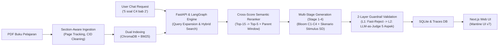

# ARCHITECTURE — RAG-AQG v4.0

## 1. Gambaran Umum Sistem

Sistem **RAG-AQG (Retrieval-Augmented Generation for Automatic Question Generation)** versi 4.0 dirancang untuk mengotomatisasi pembuatan paket soal evaluasi esai dan isian singkat berkualitas tinggi untuk jenjang Sekolah Dasar (SD, usia 6–12 tahun) pada target Taksonomi Bloom (C1–C4) berbasis buku pelajaran digital (PDF).

Arsitektur sistem dipisahkan secara bersih antara **Backend API & Processing Engine (FastAPI + LangGraph)** dan **Frontend Web Application (Next.js 15 + Mantine UI v7)**:



1. **Section-Aware Ingestion & Cleaning**: Upload PDF $\rightarrow$ Ekstraksi berbasis nomor halaman fisik (`PageContent`) $\rightarrow$ Normalisasi CID & font doubling $\rightarrow$ Filter Front/Back-Matter $\rightarrow$ Section-Aware Chunking (200–450 kata berbasis heading & batas paragraf) $\rightarrow$ Structural Tagging (`materi_pokok`, `uraian_materi`, `studi_kasus`, `aktivitas_diskusi`, `rangkuman`) $\rightarrow$ ChromaDB Dense Vector Index (dengan metadata `document_id`, `page_number`, `chunk_index`, `section_type`) + BM25 Sparse Index (dengan stopword Bahasa Indonesia).
2. **High-Precision Retrieval & Expansion**: User Chat Request $\rightarrow$ Query Transformation & Chapter Topic Expansion $\rightarrow$ Hybrid Search (Filtered Dense + BM25) $\rightarrow$ Anti-Exercise Filter $\rightarrow$ Cross-Score Semantic Reranking (70% Semantic Similarity + 30% RRF Score) menyaring Top-15 kandidat menjadi Top-5 $\rightarrow$ Parent Context Window Expansion ke prompt generator.
3. **Multi-Stage Pedagogical Generation (LangGraph)**: Stage 1 (Context Analysis) $\rightarrow$ Stage 2 (Cognitive Bloom Planning + Skenario Stimulus SD) $\rightarrow$ Stage 3 (Question Blueprinting) $\rightarrow$ Stage 4 (Question Packaging: Soal + Stimulus + Kunci Jawaban Edukatif + Penjelasan Ramah Anak).
4. **2-Layer Guardrail Validation & Self-Refinement**: 
   - **Lapis 1 (Fast-Reject Filter)**: Non-LLM Cosine Similarity terhadap `grounding_evidence` ($< 0.40 \rightarrow$ tolak cepat ke refinement untuk menghemat token juri).
   - **Lapis 2 (LLM-as-Judge 5 Aspek SD)**: Evaluasi semantik mendalam oleh LLM Judge ($T=0.05$) untuk 5 aspek: *Grounding Faktual*, *Bloom Adherence (dengan verifikasi stimulus konkret C3/C4)*, *Bahasa Indonesia Ramah Anak SD*, *Answerability*, dan *Answer Alignment*.
   - **Smart Refinement Router**: Perbaikan terarah ke Stage 4 (Refinement A) atau Stage 2–3 (Refinement B) hingga maksimal 3 percobaan.
5. **Observability & Traceability**: Setiap soal menyimpan jejak eksekusi lengkap (`prompt_traces`, `validation_logs`, `quality_warnings`, `used_chunks` dengan referensi nomor halaman buku asli).

---

## 2. Tech Stack v4.0

| Layer | Teknologi | Rincian & Peran |
|---|---|---|
| **1. Package Manager (Backend)** | `uv` | Manajemen dependensi Python, virtual environment, dan lockfile ultra cepat. |
| **2. Backend Framework** | FastAPI (Python 3.11+) | Async REST API, CORS Middleware, background task management, Pydantic v2 schemas. |
| **3. RAG & Workflow Orchestration** | LangGraph & LangChain | StateGraph multi-stage orchestrator (`AQGState`), conditional edges, node routing. |
| **4. Ingestion & Document Processing** | `pdfplumber` / `pypdf` | Ekstraksi per halaman fisik, normalisasi karakter ligatur CID Kemdikbud, font doubling cleaner. |
| **5. Chunking Strategy** | `SectionAwareChunker` | Pemotongan adaptif hierarki heading & batas paragraf (200–450 kata) dengan overlap 2 kalimat. |
| **6. Embedding & Vector DB** | `BAAI/bge-m3` + ChromaDB | Dense vector search berdimensi 1024 dengan metadata filter wajib `document_id`. |
| **7. Lexical Search** | BM25 (`rank_bm25`) | In-memory lexical search dengan tokenizer stopword Bahasa Indonesia. |
| **8. Reranking Engine** | Cross-Score Semantic Reranker | RRF weighted fusion (0.6 Dense / 0.4 Sparse) + re-scoring semantik 70/30 (Top-15 $\rightarrow$ Top-5). |
| **9. LLM Inference Endpoint** | DeepInfra / OpenAI-compatible API | **Generator**: `Qwen/Qwen3-32B` (atau `google/gemma-4-31b-it`).<br/>**Judge**: `meta-llama/Llama-3.3-70B-Instruct-Turbo` ($T=0.05$). |
| **10. Relational Database** | SQLite (WAL Mode) | Penyimpanan tabel relasional: `documents`, `chunks`, `chat_sessions`, `chat_messages`, `questions`, `validation_logs`. |
| **11. Frontend Runtime & Package Manager** | `bun` | JavaScript runtime, builder, dan package manager untuk ekosistem Node/React. |
| **12. Frontend Framework** | Next.js 15 (App Router, TypeScript) | Server & Client Components, routing modern, suspense boundaries. |
| **13. UI Component Library** | Mantine UI v7 (`@mantine/core`, `@mantine/dropzone`, `@mantine/notifications`) | Modern design system, drawer inspektor chunk, visualisasi trace multi-stage. |

---

## 3. Struktur Direktori Proyek

```text
Testing Program v3/
├── backend/
│   ├── configs/
│   │   └── settings.yaml             # Konfigurasi terpusat (LLM, Chunking, Retrieval, Validation)
│   ├── pyproject.toml                # Definisi dependensi backend (uv)
│   ├── uv.lock
│   ├── tests/                        # 28 Unit & Integration Test Suite
│   │   ├── test_backend.py
│   │   ├── test_grounding_checker.py
│   │   ├── test_hybrid_search.py
│   │   ├── test_multistage_prompting.py
│   │   └── test_quality_checks.py
│   └── src/app/
│       ├── main.py                   # FastAPI Application Entrypoint & Lifespan
│       ├── api/v1/                   # REST API Endpoints (documents, chat, questions)
│       ├── core/                     # Config loader (Pydantic Settings) & Database session
│       ├── models/                   # SQLAlchemy ORM Models (db_models.py)
│       ├── schemas/                  # Pydantic API Schemas (api_schemas.py)
│       ├── services/
│       │   ├── ingestion/            # extractor.py, classifiers.py, factory.py, chunkers/
│       │   │   └── chunkers/         # section_aware_chunker.py, fixed_chunker.py, semantic_chunker.py
│       │   ├── retrieval/            # dense_index.py, sparse_index.py, hybrid_search.py
│       │   ├── generation/           # prompts.py, schemas.py, stage_runners.py
│       │   └── validation/           # grounding_checker.py, quality_checks.py, embedding_cache.py
│       └── graph/                    # LangGraph Orchestration (state.py, nodes.py, edges.py, workflow.py)
├── frontend/
│   ├── package.json
│   ├── bun.lock
│   ├── next.config.ts
│   └── src/
│       ├── app/                      # Next.js App Router Pages
│       │   ├── page.tsx              # Home / Dashboard
│       │   ├── documents/page.tsx    # Manajemen Dokumen PDF & Chunk Drawer
│       │   ├── chat/page.tsx         # AQG Chatbot Stream & Generator
│       │   └── questions/page.tsx    # Bank Soal & Multi-Stage Trace Inspector
│       ├── components/               # AppShell & Reusable Layout Components
│       ├── lib/                      # api.ts (REST client fetch wrapper)
│       └── types/                    # TypeScript Data Interfaces (document.ts, chat.ts, question.ts)
└── docs/                             # Dokumentasi Arsitektur, PRD, Diagram, dan Prompting
    ├── ARCHITECTURE.md
    ├── DIAGRAM_SKEMA_SISTEM.md
    ├── PRD.md
    ├── SKEMA_BACKEND_LENGKAP.md
    └── skema-prompting-rag-aqg.md
```
