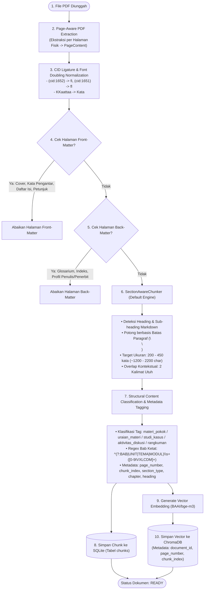
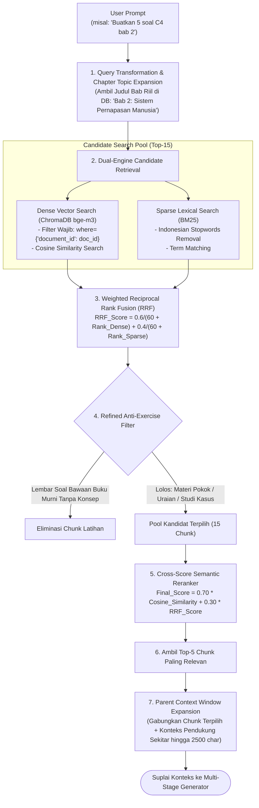
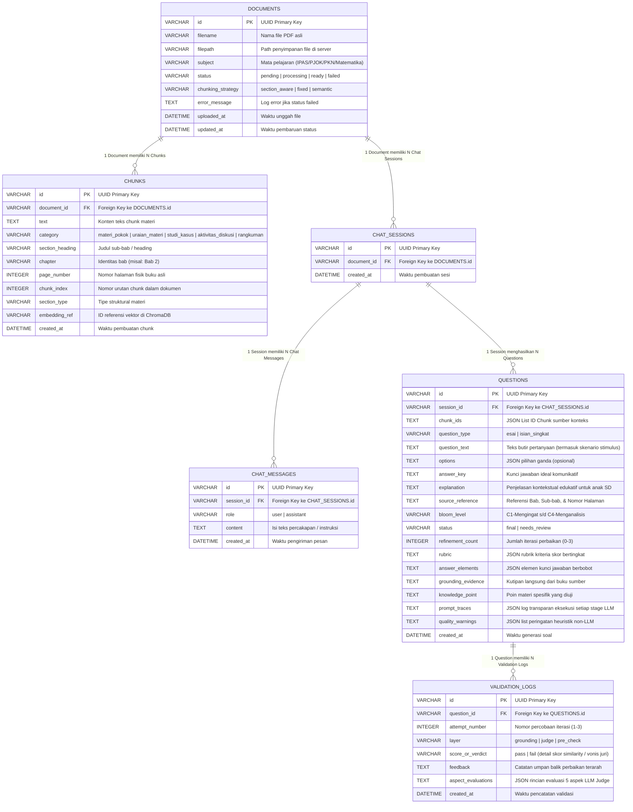

# Diagram Skema Sistem Menyeluruh (RAG-AQG v4.0)

Dokumen ini berisi kumpulan diagram visual berbasis **Mermaid** yang menjelaskan seluruh skema arsitektur, alur data (*data flow*), orkestrasi *state graph*, dan hubungan basis data sistem **RAG-AQG (Retrieval-Augmented Generation for Automatic Question Generation)** versi 4.0.

---

## 1. Diagram Arsitektur Global & Alur End-to-End

Diagram ini memvisualisasikan bagaimana setiap komponen (Frontend, FastAPI Router, Ingestion, Storage, LangGraph Engine, dan LLM/Embedding Models) saling terhubung secara modular.

```mermaid
flowchart TB
    subgraph ClientLayer ["1. Frontend Web Layer (Next.js 15 + Mantine UI v7)"]
        UI_Upload["Halaman Manajemen Dokumen PDF\n(Dropzone & Chunk Drawer)"]
        UI_Chat["Antarmuka AQG Chatbot Stream\n(Intent Parser & Suggestion Chips)"]
        UI_Audit["Halaman Bank & Trace Inspector\n(4 Stages, 2-Layer Logs, Used Chunks)"]
    end

    subgraph APILayer ["2. Backend API Layer (FastAPI v1)"]
        EP_Doc["/api/v1/documents\n(Upload, Page Extraction, Chunks)"]
        EP_Chat["/api/v1/chat\n(Sessions, Messages, Background Trigger)"]
        EP_Quest["/api/v1/questions\n(List, Detail, Prompt Traces, Logs)"]
    end

    subgraph IngestionEngine ["3. Ingestion & Preprocessing Pipeline"]
        PDF_Extract["PDF Page-Aware Extractor\n(PageContent Dataclass)"]
        Font_Norm["CID Ligature & Font Cleaner\n((cid:1652) -> fi, KKaattaa -> Kata)"]
        FBM_Filter["Front & Back Matter Filter\n(Prakata, Daftar Isi, Glosarium, Indeks)"]
        Section_C["SectionAwareChunker (Default)\n(200-450 kata, Heading & Paragraph Split)"]
        Struct_Tag["Structural Content Classifier\n(materi_pokok, uraian, studi_kasus, rangkuman)"]
    end

    subgraph StorageLayer ["4. Persistence & Index Layer"]
        DB_Relational[("SQLite Database (WAL Mode)\n- documents\n- chunks (page_no, chunk_idx, sec_type)\n- chat_sessions\n- chat_messages\n- questions\n- validation_logs")]
        Vector_DB[("ChromaDB Vector Store\n(BAAI/bge-m3 Embeddings + DocID Filter)")]
        BM25_Index["BM25 Lexical Sparse Index\n(Indonesian Stopwords Tokenizer)"]
    end

    subgraph GraphEngine ["5. LangGraph AQG StateGraph Engine"]
        N1["Node 1: retrieve_context\n(Query Expansion + Hybrid Search + Reranker)"]
        N2["Node 2: generate_questions\n(Stages 1-4 + Bloom C1-C4 SD Stimulus + Parent Window)"]
        N3["Node 3: grounding_validation\n(Layer 1: Fast-Reject Cosine Sim < 0.40)"]
        N4["Node 4: llm_judge_evaluation\n(Layer 2: LLM-as-Judge 5 Aspek SD)"]
        N5["Node 5: self_refinement\n(Smart Router: Refinement A / Refinement B)"]
        N6["Node 6: persist_questions\n(Save Soal, Traces, Used Chunks, & Warnings)"]
    end

    subgraph ModelLayer ["6. Model & Inference Layer"]
        LLM_Gen["LLM Generator (Qwen-32B / Gemma-4)\n(Stage 1-4 Multi-Stage Prompts)"]
        LLM_Judge["LLM Judge (Llama-3.3-70B, T=0.05)\n(5-Aspect Elementary Rubric)"]
        Emb_Model["Embedding Model (BAAI/bge-m3)\n(Cosine Grounding & Vector Search)"]
    end

    %% Client to API
    UI_Upload -->|POST File PDF| EP_Doc
    UI_Chat -->|POST Pesan / Request Soal| EP_Chat
    UI_Audit -->|GET Detail & Traces| EP_Quest

    %% API to Ingestion
    EP_Doc -->|Background Task| PDF_Extract
    PDF_Extract --> Font_Norm --> FBM_Filter --> Section_C --> Struct_Tag
    Struct_Tag -->|Simpan Chunk & Metadata| DB_Relational
    Struct_Tag -->|Index Dense Vector| Vector_DB
    Struct_Tag -->|Index Sparse BM25| BM25_Index

    %% Chat to LangGraph
    EP_Chat -->|Trigger Background AQG| GraphEngine
    EP_Quest -->|Read Soal & Logs| DB_Relational

    %% Graph Engine Internal Flow
    N1 -->|Top-5 Reranked Context Chunks| N2
    N2 -->|Candidate Questions (Package)| N3
    N3 -->|Fast-Reject (< 0.40)| N5
    N3 -->|Pass Fast-Reject (>= 0.40)| N4
    N4 -->|Judge Pass| N6
    N4 -->|Judge Fail & Attempt < 3| N5
    N4 -->|Judge Fail & Attempt >= 3| N6
    N5 -->|Re-Evaluate| N3
    N6 -->|Next Item| N3

    %% Graph to Storage & Models
    N1 <--> Vector_DB
    N1 <--> BM25_Index
    N1 <--> DB_Relational
    N2 <--> LLM_Gen
    N3 <--> Emb_Model
    N4 <--> LLM_Judge
    N5 <--> LLM_Gen
    N6 --> DB_Relational
```

---

## 2. Diagram Pipeline Ingestion & Preprocessing Teks

Diagram ini mendetailkan bagaimana buku digital PDF diekstrak, dinormalisasi dari artefak font Kemdikbud, disaring halamannya, dan dipotong secara Section-Aware.



---

## 3. Diagram High-Precision Retrieval & Cross-Score Reranking

Diagram ini menjelaskan alur pemrosesan query pengguna, ekspansi topik bab, pencarian hybrid ber-filter, hingga pemilihan Top-5 chunk terbaik via Semantic Reranker.



---

## 4. Diagram Alur StateGraph Multi-Stage AQG & Validasi 2-Layer

Diagram ini menjelaskan alur orkestrasi LangGraph dalam merancang pedagogi kognitif, membuat stimulus nyata untuk siswa SD, dan menjalankan validasi dual-layer.

```mermaid
stateDiagram-v2
    [*] --> retrieve_context : Inisialisasi State (AQGState)
    
    retrieve_context --> generate_questions : Top-5 Chunks & Parent Window Siap
    
    state generate_questions {
        [*] --> Stage1 : Level Materi (1x Run)
        Stage1 --> Stage2 : Level Target Bloom (1x Run)
        
        state "Stage 1: Context Analysis" as Stage1 {
            direction TB
            Extract["Ekstraksi Konsep Inti, Fakta Faktual, & Testable Content"]
        }
        
        state "Stage 2: Cognitive Bloom Planning" as Stage2 {
            direction TB
            Plan["Penetapan Operasi Kognitif C1-C4 & Perancangan Stimulus_Idea SD"]
        }
        
        Stage2 --> ItemGen : Level Butir Soal (Paralel Max 3 Concurrency)
        
        state "Stage 3 & 4: Blueprint & Generation" as ItemGen {
            Stage3["Stage 3: Question Blueprint\n(Poin Uji, Stimulus_Context, & Grounding Evidence)"] --> Stage4["Stage 4: Question Packaging\n(Skenario Konkret + Pertanyaan + Kunci Jawaban Edukatif + Penjelasan Ramah Anak)"]
        }
        
        ItemGen --> DedupFilter : Deduplikasi Soal & Poin Uji
        DedupFilter --> [*] : Hasil: Raw Candidate Question Packages
    }

    generate_questions --> grounding_validation : Validasi Butir Soal ke-i
    generate_questions --> [*] : Gagal (Konteks Kosong)

    state "Lapis 1: Fast-Reject Grounding Check" as grounding_validation {
        [*] --> CheckReflective : Pre-check Anti-Reflektif
        CheckReflective --> RejectReflective : Terdeteksi Soal Reflektif
        CheckReflective --> CalcCosine : Hitung Cosine Sim (bge-m3) vs Grounding Evidence
        
        CalcCosine --> FastReject : Score < 0.40 (Tolak Cepat ke Refinement)
        CalcCosine --> FastPass : Score >= 0.40 (Lolos ke LLM Judge)
    }

    grounding_validation --> self_refinement : Fast-Reject (< 0.40) & Attempt < 3
    grounding_validation --> persist_questions : Fast-Reject & Attempt >= 3 (status = needs_review)
    grounding_validation --> llm_judge_evaluation : Score >= 0.40 (Wajib Masuk Juri)

    state "Lapis 2: LLM-as-Judge Evaluation (5 Aspek SD)" as llm_judge_evaluation {
        [*] --> Eval5Aspects
        state Eval5Aspects {
            A1["1. Grounding Faktual (Bebas Halusinasi)"]
            A2["2. Bloom Adherence (Verifikasi Stimulus Nyata C3/C4)"]
            A3["3. Bahasa Indonesia Ramah Anak SD (6-12 Thn)"]
            A4["4. Answerability (Keterjawaban Materi)"]
            A5["5. Answer Alignment (Ketepatan Kunci Jawaban)"]
        }
        Eval5Aspects --> JudgePass : Overall == 'pass'
        Eval5Aspects --> JudgeFail : Overall == 'fail' (failed_stage: planning / generation)
    }

    llm_judge_evaluation --> persist_questions : Judge Pass (status = final)
    llm_judge_evaluation --> self_refinement : Judge Fail & Attempt < 3
    llm_judge_evaluation --> persist_questions : Judge Fail & Attempt >= 3 (status = needs_review)

    state "Node 5: Smart Self-Refinement Router" as self_refinement {
        [*] --> CheckFailedStage
        CheckFailedStage --> RefinementB : failed_stage == 'planning' (Redesign Bloom & Blueprint)
        CheckFailedStage --> RefinementA : failed_stage == 'generation' (Perbaiki Redaksi, Stimulus & Jawaban)
        RefinementB --> S3_Rerun : Re-run Stage 3 & 4
        RefinementA --> S4_Repair : Direct Text Repair di Stage 4
        S3_Rerun --> [*]
        S4_Repair --> [*]
    }

    self_refinement --> grounding_validation : Re-validasi Soal Hasil Refinement (Attempt + 1)

    state "Node 6: Persist Questions & Traces" as persist_questions {
        [*] --> HeuristicCheck : Cek Heuristik Kualitas Non-LLM
        HeuristicCheck --> SaveDB : Simpan ke SQLite (Question, Used Chunks, Traces, & Logs)
        SaveDB --> [*]
    }

    persist_questions --> grounding_validation : Masih Ada Butir Soal Berikutnya (i < Total)
    persist_questions --> [*] : Semua Soal Selesai & Kirim Response Ringkas ke Chat
```

---

## 5. Entity Relationship Diagram (ERD Basis Data Lengkap)

Diagram ini menjelaskan struktur skema tabel relasional SQLite dan relasi antar-entitas data dalam sistem RAG-AQG v4.0.


