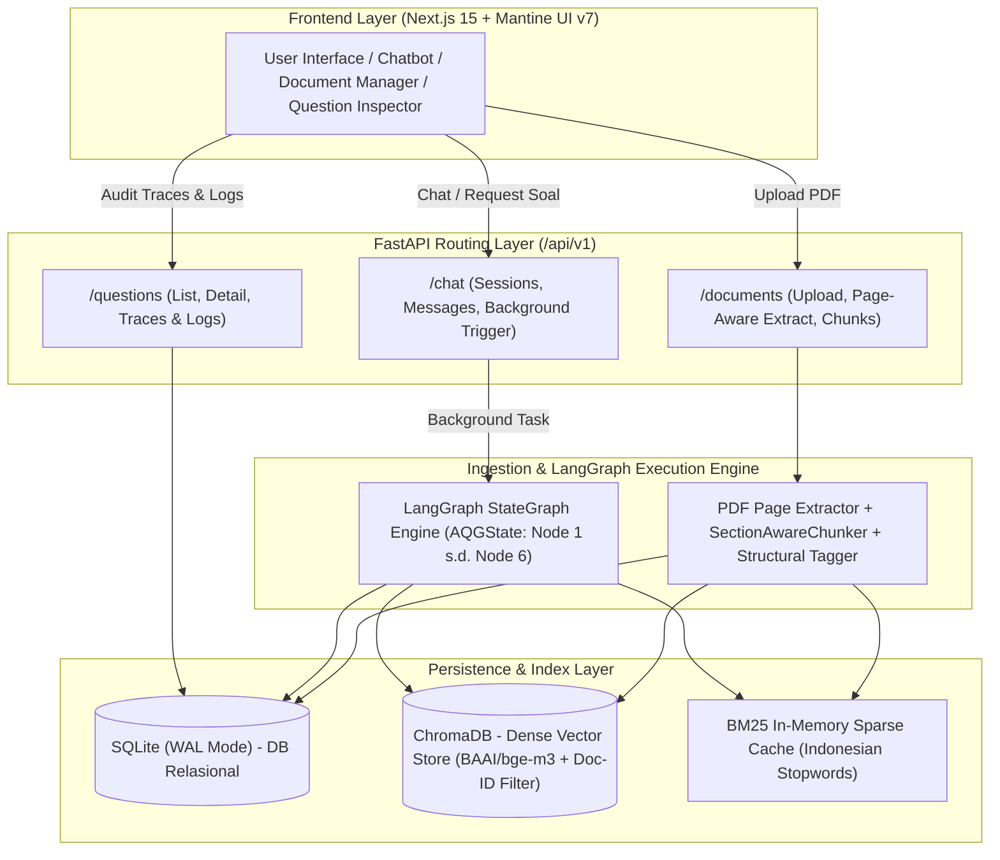
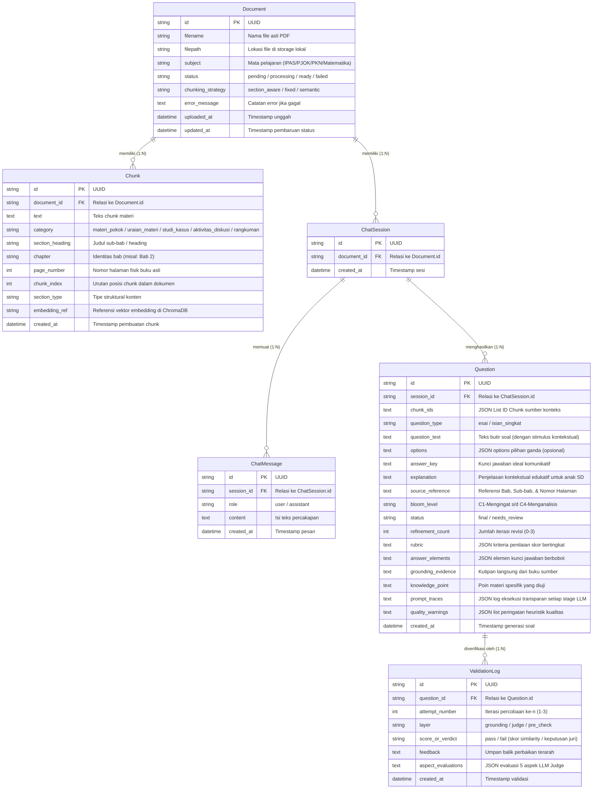
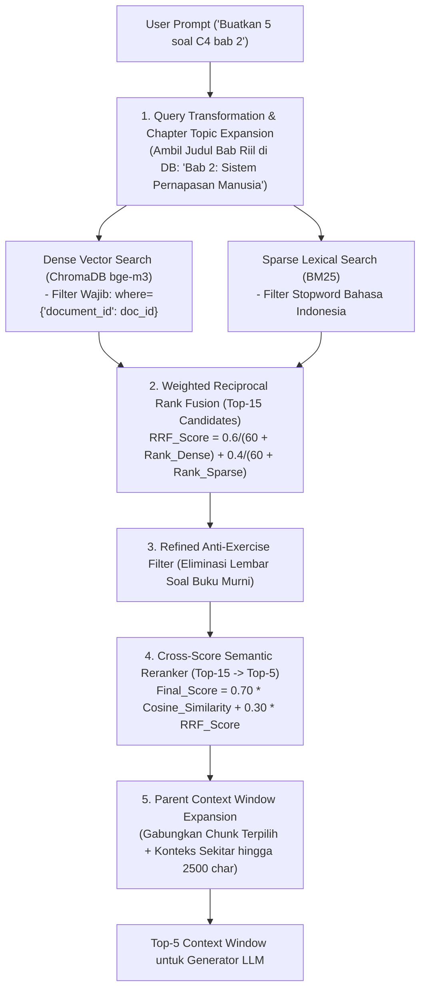
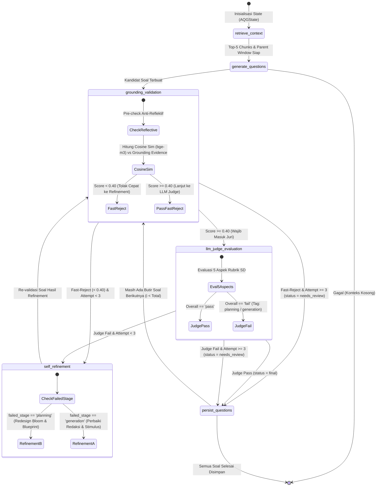
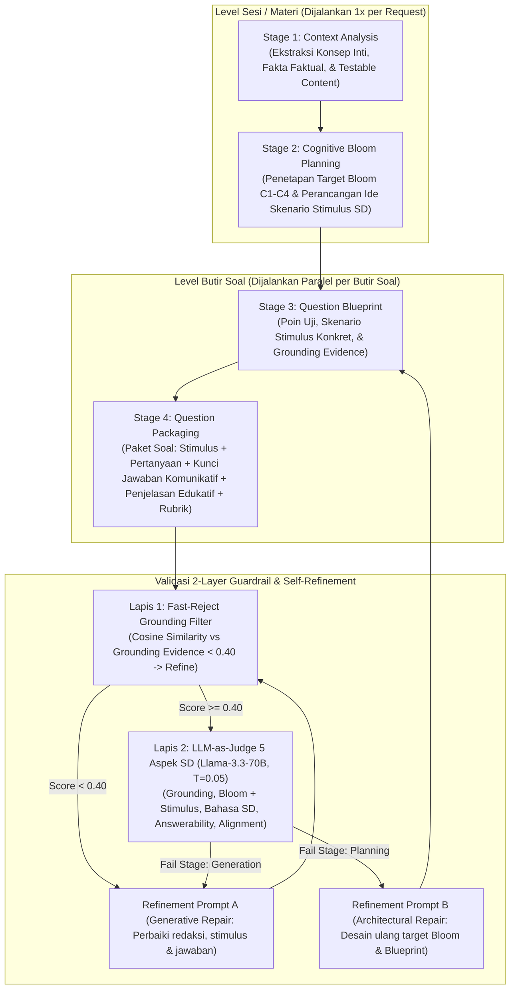

# Dokumentasi Komprehensif Skema & Arsitektur Backend RAG-AQG v4.0

Dokumen ini menjelaskan secara menyeluruh arsitektur, skema basis data, alur orkestrasi LangGraph, strategi *Section-Aware chunking* dan *hybrid retrieval*, skema *multi-stage prompting*, validasi 2-lapis, hingga kontrak API RESTful pada backend sistem **RAG-AQG (Retrieval-Augmented Generation for Automatic Question Generation)** versi 4.0.

---

## 1. Gambaran Umum Sistem & Arsitektur

Backend RAG-AQG dibangun menggunakan **FastAPI (Python 3.11+)** dengan orkestrasi pipeline berbasis **LangChain & LangGraph StateGraph**. Sistem dirancang untuk mengotomatisasi pembuatan paket soal evaluasi esai dan isian singkat berbasis buku pelajaran digital (PDF) dengan jaminan *grounding* faktual tinggi dan kesesuaian target kognitif **Taksonomi Bloom (C1–C4 SD)**.



---

## 2. Skema Basis Data & Entity Relationship (ERD)

Sistem menggunakan **SQLite** (dikonfigurasi dengan `PRAGMA journal_mode=WAL` dan `busy_timeout=30000` untuk mendukung akses asinkron konkurensi tinggi) sebagai database relasional utama dan **ChromaDB** sebagai basis data vektor (*dense embeddings*).

### 2.1 Entity Relationship Diagram (ERD)



---

## 3. Ingestion Pipeline & Section-Aware Chunking

Pipeline *ingestion* bertanggung jawab memproses buku pelajaran digital menjadi unit-unit materi yang koheren, melacak nomor halaman fisik asli, dan menandai tipe struktural materi.

```mermaid
flowchart TD
    A[Upload File PDF] --> B[Page-Aware PDF Extractor]
    B --> B0["Ekstraksi per Halaman Fisik (PageContent)"]
    B0 --> B1["Normalisasi Ligatur CID ((cid:1652) -> fi) & Font Doubling (KKaattaa -> Kata)"]
    B1 --> B2["Penyaringan Halaman Front-Matter (Cover, Prakata, Daftar Isi, Petunjuk)"]
    B2 --> B3["Penyaringan Halaman Back-Matter (Glosarium, Indeks, Profil Penulis)"]
    B3 --> C{Pilih Strategi Chunking}
    
    C -->|Section-Aware (Default)| D["SectionAwareChunker\n- Potong berbasis Hierarki Heading & Paragraf (\\n\\n)\n- Target: 200 - 450 kata (~1200 - 2200 char)\n- Overlap Kontekstual: 2 Kalimat Utuh"]
    C -->|Fixed Chunking| E[FixedChunker: 1000 Karakter, Overlap 150]
    C -->|Semantic Chunking| F[SemanticChunker: Cosine Distance Percentile 95%]
    
    D --> G[Structural Content Classifier]
    E --> G
    F --> G
    
    G --> G1["Tagging Tipe: materi_pokok / uraian_materi / studi_kasus / aktivitas_diskusi / rangkuman"]
    G --> G2["Ekstraksi Bab Ketat: ^(?:BAB|UNIT|TEMA|MODUL)\\s+([0-9IVXLCDM]+)"]
    
    G1 --> H[Simpan ke SQLite Table 'chunks' beserta page_number, chunk_index, section_type]
    G2 --> H
    H --> I["Index Dense Embeddings ke ChromaDB (BAAI/bge-m3) dengan metadata document_id"]
    H --> J["Index Sparse BM25 dengan Indonesian Stopwords Tokenizer"]
```

### 3.1 Detail Komponen Ingestion:
1. **Ekstraksi Halaman Fisik (`extractor.py`)**:
   - Menghasilkan daftar objek `PageContent(page_number: int, text: str)`. Nomor halaman ini dipertahankan hingga butir soal akhir (`UsedChunk.page_number`).
2. **Pembersihan Artefak CID & Font Normalization**:
   - `normalize_cid_and_fonts`: Memperbaiki karakter ligatur yang rusak akibat font embedded PDF Kemdikbud (`(cid:1652)` $\rightarrow$ `fi`, `(cid:1651)` $\rightarrow$ `fl`, `(cid:1650)` $\rightarrow$ `ff`) serta deduplikasi karakter ganda (`PPeettaa` $\rightarrow$ `Peta`).
3. **Section-Aware Chunking (`section_aware_chunker.py`)**:
   - Memotong teks berdasarkan batas semantik heading (`#`, `##`, `BAB`, `Sub-bab`) dan batas paragraf (`\n\n`), menjamin ide sains tidak terpotong di tengah kalimat.
   - Ukuran chunk berada pada rentang optimal representasi vektor ($200 - 450\text{ kata}$ atau $\approx 1200 - 2200\text{ karakter}$).
4. **Structural Content Classification (`classifiers.py`)**:
   - Mengelompokkan teks ke dalam kategori struktural: `materi_pokok`, `uraian_materi`, `studi_kasus`, `aktivitas_diskusi`, `rangkuman`.
   - Menggunakan regex judul bab ketat sehingga hanya bab sesungguhnya yang terdeteksi, bukan frasa percakapan seperti *"Pada bab ini"*.

---

## 4. Pipeline Retrieval & Hybrid Search Ber-Reranker

Untuk memastikan konteks yang relevan, bebas kebocoran antar-buku, dan berperingkat semantik tertinggi, sistem menerapkan **Hybrid Retrieval** dengan **Cross-Score Semantic Reranker**:



### 4.1 Formula Cross-Score Semantic Reranker
Kandidat 15 chunk teratas dari RRF dinilai ulang secara semantik sebelum masuk ke prompt LLM:

$$\text{Final\_Score}(d) = 0.70 \times \text{Cosine\_Similarity}(q, d) + 0.30 \times \text{RRF\_Score}(d)$$

---

## 5. LangGraph StateGraph & Multi-Stage AQG Pipeline

Inti dari proses pembuatan soal dijalankan oleh **LangGraph StateGraph Engine**. Pipeline ini memisahkan tahap pemahaman materi, perancangan pedagogis kognitif, perancangan stimulus kontekstual, pembuatan soal, dan validasi berlapis.

### 5.1 Diagram StateGraph & Routing Validasi



### 5.2 Struktur `AQGState` (TypedDict)

```python
class AQGState(TypedDict):
    # Parameter Input
    session_id: str
    document_id: str
    user_prompt: str
    chapter: str | None
    bloom_level: str | None
    num_questions: int

    # Konteks Materi
    retrieved_chunks: list[dict[str, Any]]
    source_chunk_ids: list[str]
    chat_history: str

    # Artefak Multi-Stage
    content_analysis: dict[str, Any]      # Hasil Stage 1
    cognitive_plan: dict[str, Any]        # Hasil Stage 2 (termasuk stimulus_idea)
    question_blueprint: dict[str, Any]    # Hasil Stage 3 (termasuk stimulus_context)
    raw_questions: list[dict[str, Any]]

    # Tracking Validasi Per Butir Soal
    current_q_index: int
    current_question: dict[str, Any]
    current_attempt: int
    max_attempts: int
    failed_stage: str | None              # "planning" | "generation" | "none"
    judge_evaluation: dict[str, Any] | None

    # Traces & Output
    stage_traces: list[dict[str, Any]]
    validation_logs: Annotated[list[dict[str, Any]], operator.add]
    finalized_questions: Annotated[list[dict[str, Any]], operator.add]
    error: str | None
```

---

## 6. Detail Tahapan Multi-Stage Generation & Validasi 2-Layer



### 6.1 Rincian 4 Stage Generation:
1. **Stage 1: Context Analysis**:
   - Menghasilkan model Pydantic `ContentAnalysis` (`topic`, `key_concepts`, `key_facts`, `testable_content` dengan kutipan kalimat asli `source_quote`).
2. **Stage 2: Cognitive Bloom Planning**:
   - Menghasilkan `CognitivePlan` (`target_bloom_level`, `kko_verbs`, `cognitive_task_type`, `stimulus_idea` khusus dunia nyata anak SD).
3. **Stage 3: Question Blueprint**:
   - Menghasilkan `QuestionBlueprint` (`knowledge_point`, `grounding_evidence`, `question_type`, `stimulus_context`).
4. **Stage 4: Question Packaging**:
   - Menghasilkan `QuestionPackage` (`question` [stimulus + pertanyaan], `expected_answer` [jawaban ideal komunikatif], `explanation` [penjelasan edukatif ramah anak], `rubric` [penskoran bertingkat 0, 1, 2]).

### 6.2 Validasi Lapis 1: Fast-Reject Grounding Filter
- Menghitung kemiripan kosinus antara teks $\text{Soal} + \text{Jawaban}$ terhadap `grounding_evidence` spesifik menggunakan model `BAAI/bge-m3`.
- **Threshold**:
  - $< 0.40$: **Fast-Reject / Fail** (langsung ditolak ke self-refinement tanpa memboroskan token LLM Judge).
  - $\ge 0.40$: **Pass Fast-Reject** (wajib dilanjutkan ke Lapis 2 LLM-as-Judge).

### 6.3 Validasi Lapis 2: LLM-as-Judge 5 Aspek SD
Model juri mengevaluasi soal dengan suhu rendah ($T=0.05$) pada 5 dimensi rubrik:
1. `grounding`: Apakah fakta dalam soal dan jawaban 100% didukung konteks (bebas halusinasi)?
2. `bloom_adherence`: Apakah tuntutan kognitif sesuai target Bloom C1–C4 dan **memiliki skenario stimulus nyata untuk soal level C3/C4**?
3. `bahasa`: Apakah kalimat sederhana, komunikatif, dan sesuai untuk siswa SD usia 6–12 tahun?
4. `answerability`: Apakah soal dapat dijawab tuntas hanya berdasarkan materi buku?
5. `answer_alignment`: Apakah kunci jawaban menjawab tepat inti pertanyaan yang diajukan?

---

## 7. Skema API Endpoints (FastAPI v1)

Semua endpoint API beralamat di bawah *prefix* `/api/v1`.

| HTTP Method | Path Endpoint | Request Body / Query | Response Model | Deskripsi Fungsi |
|---|---|---|---|---|
| `GET` | `/health` / `/` | - | `{"status": "ok", "version": "4.0.0"}` | Pemeriksaan kesehatan layanan (*health check*). |
| `POST` | `/api/v1/documents/` | `Multipart/Form-Data` (`file`, `subject`, `chunking_strategy`) | `DocumentUploadResponse` | Mengunggah PDF dan menjalankan pipeline ekstraksi materi berbasis halaman di background. |
| `GET` | `/api/v1/documents/` | - | `list[DocumentStatusResponse]` | Mengambil daftar seluruh dokumen yang tersimpan. |
| `GET` | `/api/v1/documents/{id}` | - | `DocumentStatusResponse` | Mengambil status dokumen (`pending`/`processing`/`ready`/`failed`). |
| `GET` | `/api/v1/documents/{id}/chunks` | - | `list[ChunkResponse]` | Mengambil daftar seluruh chunk hasil segmentasi dokumen beserta nomor halaman fisik dan tag struktural. |
| `DELETE` | `/api/v1/documents/{id}` | - | `{"status": "deleted"}` | Menghapus dokumen dari database relasional dan ChromaDB. |
| `GET` | `/api/v1/chat/sessions` | `?document_id=<str>` | `list[ChatSessionListItem]` | Mengambil daftar sesi percakapan (opsional filter per dokumen). |
| `POST` | `/api/v1/chat/sessions` | `{"document_id": "<str>"}` | `ChatSessionResponse` | Membuat sesi percakapan baru untuk dokumen tertentu. |
| `DELETE` | `/api/v1/chat/sessions/{id}` | - | `{"status": "deleted"}` | Menghapus sesi percakapan beserta seluruh pesan dan soal terkait. |
| `GET` | `/api/v1/chat/sessions/{id}/messages`| - | `list[ChatMessageResponse]` | Mengambil riwayat pesan percakapan dalam suatu sesi. |
| `POST` | `/api/v1/chat/sessions/{id}/messages`| `{"content": "<str>"}` | `ChatMessageResponse` | Mengirim pesan. Jika terdeteksi perintah pembuatan soal, LangGraph dipicu di background. |
| `GET` | `/api/v1/questions/` | `?session_id=<str>` | `list[QuestionResponse]` | Mengambil daftar soal yang dihasilkan (bisa difilter per sesi). |
| `GET` | `/api/v1/questions/{id}` | - | `QuestionDetailResponse` | Mengambil rincian butir soal, jejak eksekusi (*prompt traces*), log validasi 2-layer, dan chunk sumber beserta nomor halaman. |

---

## 8. Skema Konfigurasi Sistem (`settings.yaml`)

Konfigurasi dikelola secara tersentralisasi melalui file `backend/configs/settings.yaml` (dikelola oleh Pydantic v2 `Settings` pada `app.core.config`):

```yaml
app:
  backend_host: "0.0.0.0"
  backend_port: 8000
  frontend_port: 3000
  cors_origins:
    - "http://localhost:3000"

llm:
  provider: "deepinfra"                     # Pilihan: "deepinfra", "openai", "groq", "openrouter", "ollama"
  deepinfra_api_key: "${DEEPINFRA_API_KEY}"
  deepinfra_base_url: "https://api.deepinfra.com/v1/openai"
  generator_model: "Qwen/Qwen3-32B"
  judge_model: "meta-llama/Llama-3.3-70B-Instruct-Turbo"
  embedding_model: "BAAI/bge-m3"

validation:
  grounding_threshold: 0.40                 # Fast-Reject threshold Lapis 1
  fast_reject_threshold: 0.40               # Threshold penolakan cepat non-LLM
  max_refinement_attempts: 3                # Maksimal perbaikan per butir soal

database:
  url: "sqlite:///./data/rag_aqg.db"
  chroma_persist_dir: "./data/chroma"

retrieval:
  top_k: 5
  candidate_top_k: 15
  reranker_enabled: true
  hybrid_dense_weight: 0.6
  hybrid_sparse_weight: 0.4

chunking:
  strategy: "section_aware"                 # Pilihan: "section_aware", "fixed", "semantic"
  target_word_min: 200
  target_word_max: 450
  sentence_overlap: 2
  fixed_chunk_size: 1000
  fixed_chunk_overlap: 150
  semantic_breakpoint_type: "percentile"
  semantic_breakpoint_threshold: 95
```

---

## 9. Sistem Audit & Traceability (Observability)

Setiap butir soal menyimpan metadata diagnostik mendalam untuk keperluan audit dan analisis riset skripsi:
1. **`prompt_traces`**: Merekam *raw prompt* yang dikirimkan, *raw output* LLM, output hasil parsing Pydantic, durasi latensi (*latency ms*), dan status fallback pada setiap tahap (*Stage 1 s/d Stage 4, Judge, dan Refinement*).
2. **`validation_logs`**: Menyimpan riwayat setiap iterasi validasi (*attempt number*, *layer*, *score/verdict*, evaluasi breakdown 5 aspek juri, serta alasan perbaikan).
3. **`quality_warnings`**: Mendeteksi isu heuristik non-LLM seperti panjang jawaban esai yang terlalu pendek/panjang atau tanda baca yang tidak tepat.
4. **`used_chunks`**: Menyimpan kutipan chunk materi lengkap dengan referensi nomor halaman buku asli (`page_number`), indeks urutan chunk (`chunk_index`), dan tag jenis struktural (`section_type`).
